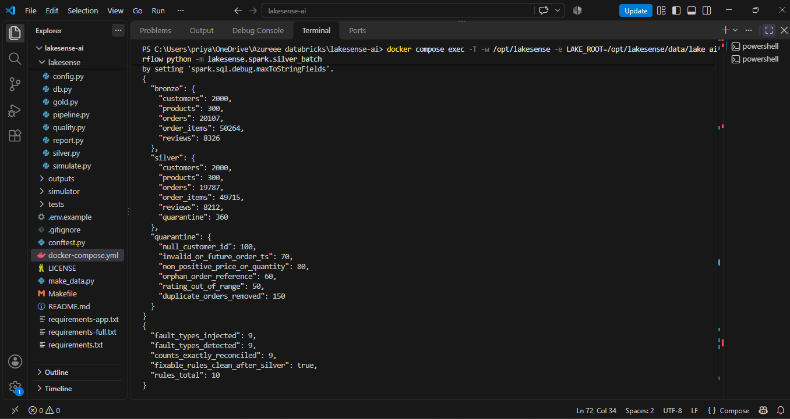
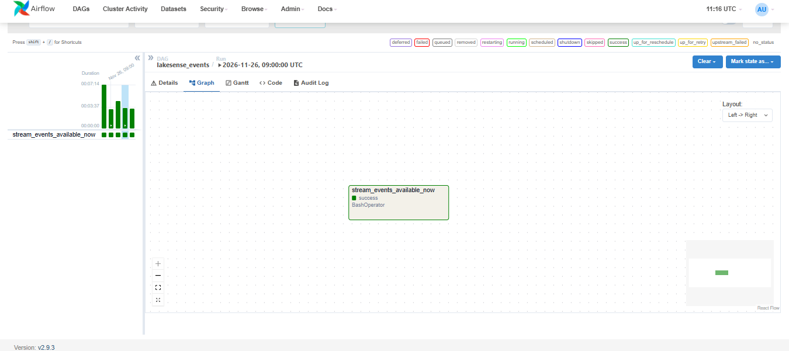
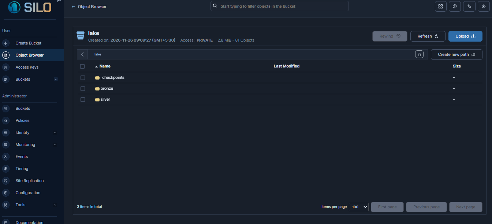
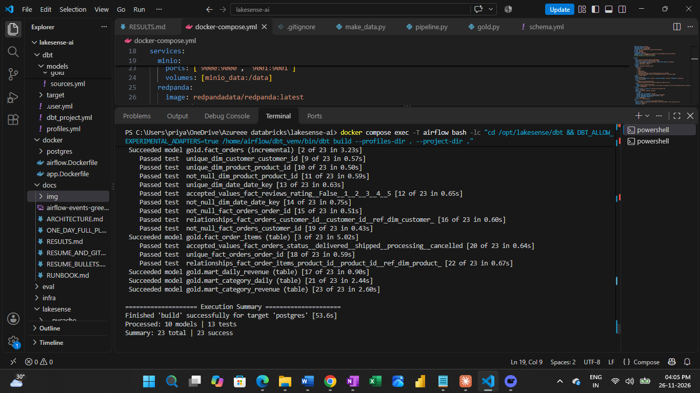
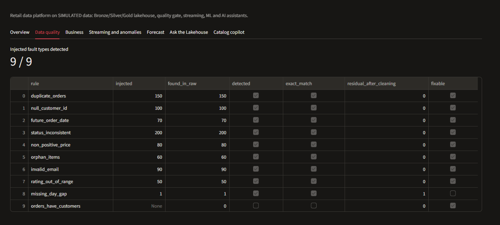
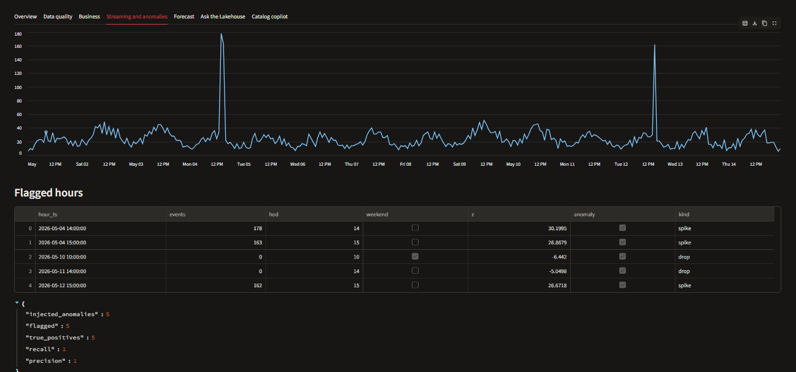
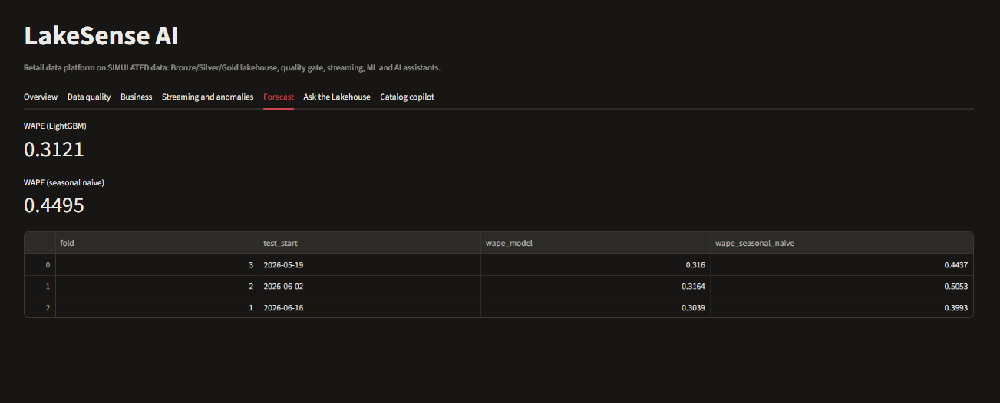

# LakeSense AI

A lakehouse I built from scratch to practise how a company turns messy data into tables it can trust. The data is simulated. I planted nine kinds of mistakes in it on purpose (duplicate orders, orders with no customer, impossible dates and more), so I could measure how well my quality checks work instead of only saying they work.

## Results

| What I measured | Result |
|---|---|
| Planted fault types caught by the quality rules | 9 of 9 |
| Quality rules | 10 |
| Bad rows moved to quarantine | 360 |
| dbt models and tests passing | 23 (10 models, 13 tests) |
| Demand forecast error (WAPE, 3-fold rolling-origin backtest), LightGBM vs seasonal-naive baseline | 0.31 vs 0.45 (31% lower) |
| Injected anomalies found in the event stream | 5 of 5 (precision 1.0) |
| SQL assistant safety | query validator, allow-listed tables, read-only database user |
| Data size | 1,958,645 raw records in the DuckDB run (all tables), about 81,000 rows in the five business tables of the Spark and Delta Lake run |
| End-to-end pipeline runtime in DuckDB | about 15 seconds |

Every number comes from my own runs. They describe this simulated benchmark, not real company data.

## Screenshots










## How it works

```
Raw files + Kafka (Redpanda) events
   -> Bronze: raw data stored as it arrived (Delta Lake)
   -> Silver: cleaned and validated, bad rows go to a quarantine table with the reason
   -> PostgreSQL -> dbt builds the Gold tables and tests them
   -> Dashboard, forecast, anomaly detection, SQL assistant
Airflow runs the event pipeline.
```

Details and design choices: [docs/ARCHITECTURE.md](docs/ARCHITECTURE.md)

## Tools

| Area | Tools |
|---|---|
| Ingestion | PySpark batch, Spark Structured Streaming, Kafka-compatible Redpanda |
| Storage | Delta Lake on MinIO (S3-compatible), DuckDB for the lightweight build |
| Transform | Spark (Silver), dbt (Gold) |
| Orchestration | Apache Airflow |
| Quality | 10 SQL rules, a quality gate, a quarantine table |
| ML | LightGBM forecast with rolling-origin backtesting, anomaly detection |
| AI | Text-to-SQL assistant with a query validator, allow-listed tables and a read-only database user |
| Serving | PostgreSQL, Streamlit |
| Engineering | Docker Compose, GitHub Actions, pytest |

## Run it yourself

Quick version, no Docker (Python 3.11 or 3.12):

```
pip install -r requirements.txt
python -m pytest -q --ignore=tests/test_spark.py
python -m lakesense.pipeline
python -m lakesense.report
streamlit run app/streamlit_app.py
```

Full version with Spark, Kafka, Airflow, dbt and PostgreSQL:

```
docker compose up -d --build
```

Then follow [docs/RUNBOOK.md](docs/RUNBOOK.md). Give Docker at least 5 GB of memory (I used 8 GB). The first start downloads a lot and can take 10 to 20 minutes.

## Problems I had to solve

- Memory: Spark, Kafka, Airflow and Postgres together needed more Docker memory than the default.
- MinIO removed its free Docker images while I was building this, so the old image names stopped working. The compose file now uses pgsty/silo, a community-maintained MinIO fork.
- The Airflow image failed to build once because a package download broke halfway. Running the build again fixed it.
- Airflow took too long to start, so I raised its start-up timeout.

## Limits

- The data is simulated, so results describe this benchmark and not a real business.
- Spark runs on one machine inside a container, not on a cluster.
- MLflow tracking is not enabled in this version.
- Next step: run the same design on a public dataset in a cloud environment.

## Author

Priyanka Selvaraj | Data Analyst moving into Data Engineering | [LinkedIn](https://www.linkedin.com/in/priyankaselvaraj27)
