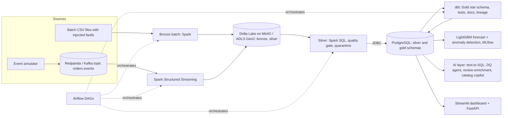

# Architecture

## Design decisions (put these in interviews)
| Decision | Why |
|---|---|
| Delta Lake for Bronze/Silver | ACID writes, schema enforcement, time travel, safe re-runs |
| Streaming with Trigger.AvailableNow | Same code handles live and batch; finite, retry-safe Airflow tasks |
| `dropDuplicatesWithinWatermark` | Bounded-state de-duplication of replayed events |
| Quarantine table instead of deleting | Auditable rejects with a reason; nothing silently disappears |
| Same quality rules on raw and clean data | Detect problems and prove they were fixed; scored against injected faults |
| dbt for Gold | Tested, documented, incremental SQL models with lineage |
| Rules written once, transpiled with sqlglot | One source of truth for DuckDB and Spark SQL |
| LLM never touches data directly | sqlglot validation, allow-listed gold tables, read-only DB role, statement timeout, audit log |
| LLM outputs validated with pydantic | Invalid output is retried or rejected, never trusted |
